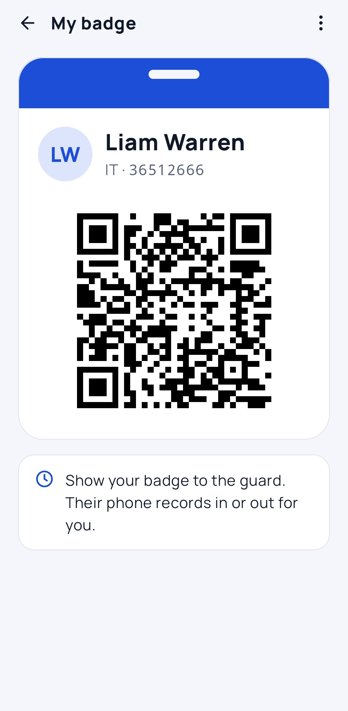
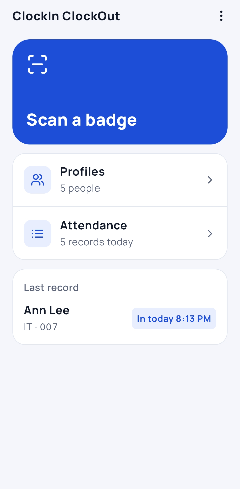
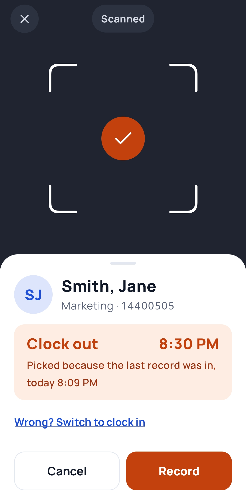
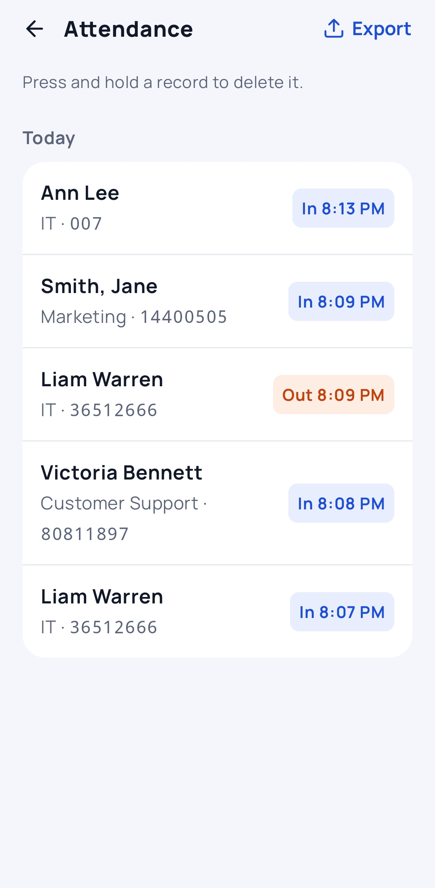

# ClockIn ClockOut

[](https://github.com/georges-ph/ClockIn-ClockOut/actions/workflows/ci.yml)
[](https://github.com/georges-ph/ClockIn-ClockOut/releases)
[](LICENSE)

A lightweight, budget-friendly Android app to **clock in** when you arrive at
work and **clock out** when you leave.

Designed for small companies: no card readers, no server and no internet.
One phone at the entrance scans badges, and everyone else shows theirs.

**Download:** [Android APK](https://github.com/georges-ph/ClockIn-ClockOut/releases/latest/download/ClockIn-ClockOut.apk)
· **Website:** [georges-ph.github.io/ClockIn-ClockOut](https://georges-ph.github.io/ClockIn-ClockOut/)

<p align="center">
  
  
  
  
</p>

## How it started

The idea came to me while watching a movie. In one scene, an employee was
leaving work and had to scan his card at the company gate to clock out. It made
me think: what about small companies? They usually don't have the budget for
dedicated hardware like card readers or access gates. So why not build a simple
alternative as a mobile app? A lightweight and affordable solution that handles
employee clock-ins and clock-outs using nothing more than a phone.

## How it works

1. **Set up the gate phone.** Import the employee list from **Profiles**, as a
   CSV file with `id`, `name` and `department` columns:

   ```csv
   id,name,department
   80811897,Victoria Bennett,Customer Support
   33660096,Grace Stevens,Engineering
   ```

2. **Give out badges.** Each employee scans their badge once from their
   profile on the gate phone, and the app opens on it from then on. Badges can
   also be shared as an image and printed.
3. **Scan at the door.** The guard scans a badge and records it. The gate
   phone picks in or out by itself, and anyone not on the list is refused.
4. **Export for HR.** **Attendance** lists every record and exports them as
   CSV. If the gate phone's clock is changed, the next record is marked with
   how far it moved.

## Building

Requirements: Android Studio, or JDK 21 and the Android SDK.

```sh
./gradlew assembleDebug
```

The APK is written to `app/build/outputs/apk/debug/`. To sign release builds
with your own key, copy `key.properties.example` to `key.properties` and fill
it in; without it, release builds use the debug key.

Run the unit tests and lint with:

```sh
./gradlew testDebugUnitTest lintDebug
```

## Tech

Kotlin and Jetpack Compose, Room for storage, CameraX with ML Kit for
on-device scanning, and ZXing to draw QR codes. Nothing leaves the phone.

## Status

Maintained as a small hobby project. Bug reports and ideas are welcome; see
[CONTRIBUTING](CONTRIBUTING.md).

## License

[MIT](LICENSE). The bundled Manrope font is under the
[SIL Open Font License](app/src/main/assets/licenses/Manrope-OFL.txt).
